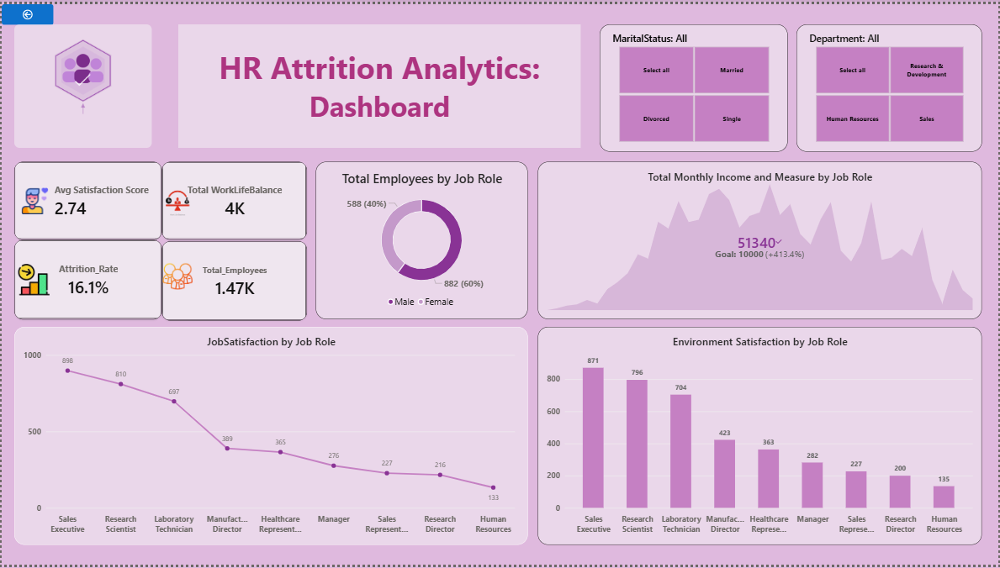

# 📊 HR Attrition Analytics Dashboard





---

## 🔍 Project Overview

This project analyzes employee attrition patterns using HR data to uncover key insights
about workforce trends, satisfaction levels, and departmental performance.
Built with **Power BI**, the dashboard provides an interactive view of HR metrics
to support data-driven decision-making.

---

## 📌 Key Metrics

| Metric | Value |
|---|---|
| Attrition Rate | 16.1% |
| Total Employees | 1.47K |
| Avg Satisfaction Score | 2.74 |
| Total Work-Life Balance | 4K |
| Total Monthly Income | 51,340 |

---

## 📈 Dashboard Features

- 🔘 **Interactive Slicers** — Filter by Marital Status & Department
- 🍩 **Employee Gender Distribution** — Male vs Female breakdown
- 📉 **Job Satisfaction by Job Role** — Line chart across all roles
- 📊 **Environment Satisfaction by Job Role** — Bar chart comparison
- 💰 **Total Monthly Income by Job Role** — Area chart with goal tracking
- 🃏 **KPI Cards** — Quick summary of key HR metrics with icons

---

## 🛠️ Tools & Technologies

- **Power BI Desktop** — Dashboard creation & visualization
- **Microsoft Excel / CSV** — Data source
- **DAX** — Calculated measures and KPIs
- **Power Query** — Data cleaning and transformation

---

## 📂 Project Structure

```

HR-Attrition-Analysis-Prediction-and-Dashboard/
│
├── HR Attrition SS.png        # Dashboard screenshot
├── HR_Attrition_Data.csv      # Dataset
├── Dashboard.pbix             # Power BI file
└── README.md                  # Project documentation
```

---

## 🚀 How to Use

1. Clone this repository
   ```bash
   git clone https://github.com/neetesh-rajpoot-18/HR-Attrition-Analysis-Prediction-and-Dashboard.git
   ```
2. Open `Dashboard.pbix` in **Power BI Desktop**
3. Explore the interactive dashboard using slicers and filters

---

## 👤 Author

**Neetesh Rajpoot**  
[


](https://github.com/neetesh-rajpoot-18)

---

⭐ *If you found this project helpful, please give it a star!*
```

---

Just update the file names (`Dashboard.pbix`, `HR_Attrition_Data.csv`) to match your actual filenames in the repo. Everything else is ready to paste directly into your `README.md`! 🚀
